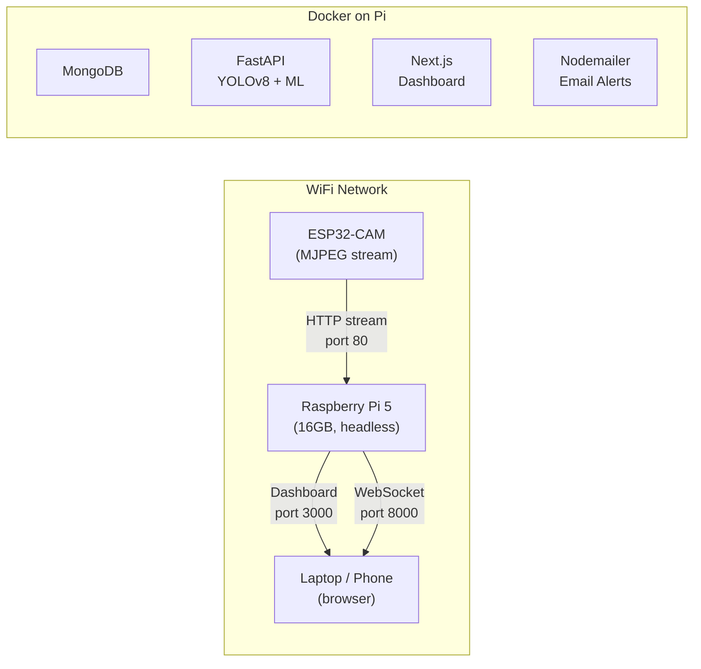

# 🔐 ThreatDetect — Raspberry Pi 5 Deployment Guide

> **Goal:** Power on the Pi → ESP32-CAM connects → demo is live at `http://<pi-ip>:3000` — zero interaction needed.

---

## Architecture Overview



---

## What You Need

| Item | Details |
|------|---------|
| **Raspberry Pi 5** | 16GB model, with power supply |
| **microSD card** | 32GB+ with Raspberry Pi OS (64-bit, Lite recommended) |
| **ESP32-CAM** | AI Thinker module, flashed with `ESP32CAM_Dynamic.ino` |
| **WiFi network** | Both Pi and ESP32-CAM on the **same WiFi** |
| **Another device** | Laptop/phone to access the dashboard |

> [!IMPORTANT]
> Use **Raspberry Pi OS Lite (64-bit)** for best performance. The desktop version wastes RAM on a GUI you won't use.

---

## Step 1: Flash the ESP32-CAM

The ESP32-CAM firmware is already in your repo at [`hardware/esp32-cam/ESP32CAM_Dynamic.ino`](file:///d:/Codes/ThreatDetect/hardware/esp32-cam/ESP32CAM_Dynamic.ino).

1. Open the sketch in Arduino IDE
2. Select board: **AI Thinker ESP32-CAM**
3. Upload the firmware
4. On first boot, the ESP32 creates an AP: **`ESP32-CAM-SETUP`**
5. Connect to it, open `http://192.168.4.1`, enter your WiFi SSID + password
6. The ESP32 connects to your WiFi and is reachable at its IP or `http://threatdetect-cam.local`

> [!TIP]
> After saving WiFi credentials, the ESP32 remembers them across reboots (stored in flash via `Preferences`). No need to reconfigure.

---

## Step 2: Set Up the Raspberry Pi

### 2a. Flash Raspberry Pi OS

1. Use **Raspberry Pi Imager** to flash **Raspberry Pi OS Lite (64-bit)**
2. In Imager settings, enable:
   - **SSH** (so you can connect headlessly)
   - **WiFi** (enter your network SSID + password)
   - Set **hostname** to `raspberrypi` (or your preference)
   - Set **username/password**

### 2b. SSH into the Pi

```bash
ssh pi@raspberrypi.local
# or
ssh pi@<pi-ip-address>
```

### 2c. Clone the repo

```bash
git clone https://github.com/your-username/ThreatDetect.git
cd ThreatDetect
```

---

## Step 3: Configure Environment

Edit [`.env.pi`](file:///d:/Codes/ThreatDetect/.env.pi) with your actual values:

```bash
nano .env.pi
```

**Critical settings to verify:**

| Variable | What to set |
|----------|-------------|
| `PI_IP` | Your Pi's LAN IP (auto-detected by setup script) |
| `FREE_ROUTER_API_KEY` | Your OpenRouter API key |
| `EMAIL_USER` | Gmail address for sending alerts |
| `EMAIL_PASSWORD` | Gmail app password (not regular password) |

> [!NOTE]  
> The setup script auto-detects `PI_IP`, but verify it matches what your router assigned.

---

## Step 4: Run the Setup Script

```bash
chmod +x pi-setup.sh
sudo ./pi-setup.sh
```

This single command:
1. ✅ Installs Docker + Docker Compose
2. ✅ Detects your Pi's LAN IP
3. ✅ Builds all 5 containers (MongoDB, Backend, Frontend, Mailer, Mongo Express)
4. ✅ Creates a **systemd service** that auto-starts everything on boot
5. ✅ Installs **Avahi** so the Pi is reachable as `raspberrypi.local`
6. ✅ Verifies all services are healthy

> [!WARNING]
> First build takes **10-20 minutes** on Pi 5 (downloading Docker images, compiling Python packages for ARM64, building Next.js). Subsequent restarts are instant.

---

## Step 5: Access the Demo

Once setup completes, open on any device on the same WiFi:

| Service | URL |
|---------|-----|
| **🖥️ Dashboard** | `http://<pi-ip>:3000` |
| **📡 Backend API** | `http://<pi-ip>:8000/health` |
| **🗄️ MongoDB UI** | `http://<pi-ip>:8081` |

### First-time use:
1. Go to `http://<pi-ip>:3000/register` — register your email
2. Go to `http://<pi-ip>:3000` — the dashboard
3. Select **ESP32-CAM** from camera type dropdown
4. Enter the ESP32's base URL (e.g., `http://192.168.1.50` or `http://threatdetect-cam.local`)
5. Click **Check connection** to verify
6. Click **Start camera**
7. 🎉 Live threat detection is running!

---

## Step 6 (Optional): Auto-Start Camera on Boot

If you want the camera pipeline to start automatically without clicking "Start" in the UI:

```bash
chmod +x pi-autostart-camera.sh
./pi-autostart-camera.sh http://192.168.1.50 your-email@example.com
```

To make this run on every boot, add it to the systemd service:

```bash
sudo nano /etc/systemd/system/threatdetect-camera.service
```

```ini
[Unit]
Description=ThreatDetect Auto-Start Camera
After=threatdetect.service
Requires=threatdetect.service

[Service]
Type=oneshot
RemainAfterExit=yes
WorkingDirectory=/home/pi/ThreatDetect
ExecStartPre=/bin/sleep 30
ExecStart=/home/pi/ThreatDetect/pi-autostart-camera.sh http://192.168.1.50 your-email@example.com

[Install]
WantedBy=multi-user.target
```

```bash
sudo systemctl daemon-reload
sudo systemctl enable threatdetect-camera.service
```

Now: **Power on → Pi boots → Docker starts → Camera auto-connects → Demo is live.**

---

## Performance Tuning for Pi 5

The [`docker-compose.pi.yml`](file:///d:/Codes/ThreatDetect/docker-compose.pi.yml) is already tuned for the Pi:

| Setting | Pi Value | Default | Why |
|---------|----------|---------|-----|
| `FRAME_WIDTH` | 640 | 1280 | Lower resolution = faster YOLO inference |
| `FRAME_HEIGHT` | 480 | 720 | Matches ESP32-CAM VGA output |
| `STREAM_TARGET_FPS` | 8 | 12 | Reduces CPU load |
| `STREAM_JPEG_QUALITY` | 65 | 75 | Smaller frames over WebSocket |
| `SNAPSHOT_REQUEST_TIMEOUT_SECONDS` | 2.0 | 1.2 | ESP32 over WiFi can be slower |

> [!TIP]
> The Pi 5 with 16GB RAM handles YOLOv8n comfortably. If you see high CPU usage, reduce `STREAM_TARGET_FPS` to `5`.

---

## Audio Analysis

Audio analysis is **completely optional**. The backend gracefully handles:
- ❌ No microphone connected → logs a warning, continues without audio
- ❌ `sounddevice` not available → skips audio entirely
- ❌ Mic disconnects mid-stream → stops audio thread, pipeline continues

If you want audio: plug in a USB microphone before starting the containers.

---

## Troubleshooting

### ESP32-CAM not reachable from Pi

```bash
# From the Pi, test the ESP32:
curl http://192.168.1.50/status

# If using mDNS:
avahi-resolve -n threatdetect-cam.local
curl http://threatdetect-cam.local/status
```

> [!WARNING]
> Many routers have **AP isolation** enabled, which blocks device-to-device communication on WiFi. Disable it in your router settings, or use Ethernet for the Pi.

### View container logs

```bash
# All services
docker compose -f docker-compose.pi.yml logs -f

# Just the backend
docker compose -f docker-compose.pi.yml logs -f backend

# Just the frontend
docker compose -f docker-compose.pi.yml logs -f frontend
```

### Restart everything

```bash
sudo systemctl restart threatdetect
```

### Rebuild after code changes

```bash
cd ~/ThreatDetect
docker compose -f docker-compose.pi.yml --env-file .env.pi up -d --build
```

### Check Pi's IP changed?

```bash
hostname -I
# Update .env.pi with new IP, then rebuild frontend:
docker compose -f docker-compose.pi.yml --env-file .env.pi up -d --build frontend
```

---

## Files Created / Modified

| File | Purpose |
|------|---------|
| [`docker-compose.pi.yml`](file:///d:/Codes/ThreatDetect/docker-compose.pi.yml) | Full-stack Docker Compose for Pi (all 5 services) |
| [`backend/Dockerfile.pi`](file:///d:/Codes/ThreatDetect/backend/Dockerfile.pi) | ARM64-optimized backend image (headless OpenCV, optional audio) |
| [`frontend/Dockerfile`](file:///d:/Codes/ThreatDetect/frontend/Dockerfile) | Updated to accept build-time env vars for Next.js |
| [`.env.pi`](file:///d:/Codes/ThreatDetect/.env.pi) | Pi-specific environment config (API keys, Pi IP) |
| [`pi-setup.sh`](file:///d:/Codes/ThreatDetect/pi-setup.sh) | One-shot setup script (Docker, systemd, mDNS) |
| [`pi-autostart-camera.sh`](file:///d:/Codes/ThreatDetect/pi-autostart-camera.sh) | Optional: auto-start ESP32-CAM pipeline on boot |
| [`backend/app/services/audio_service.py`](file:///d:/Codes/ThreatDetect/backend/app/services/audio_service.py) | Made audio fully graceful (no crash without mic) |
| [`frontend/.dockerignore`](file:///d:/Codes/ThreatDetect/frontend/.dockerignore) | Speeds up Docker builds |
| [`backend/.dockerignore`](file:///d:/Codes/ThreatDetect/backend/.dockerignore) | Speeds up Docker builds |
